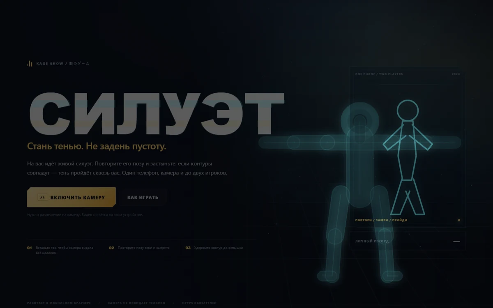
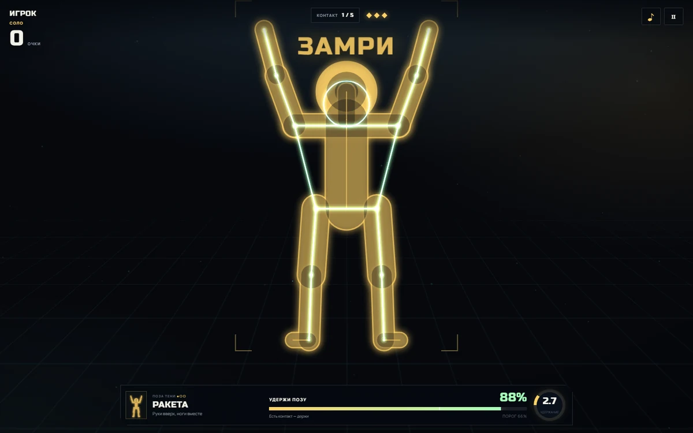
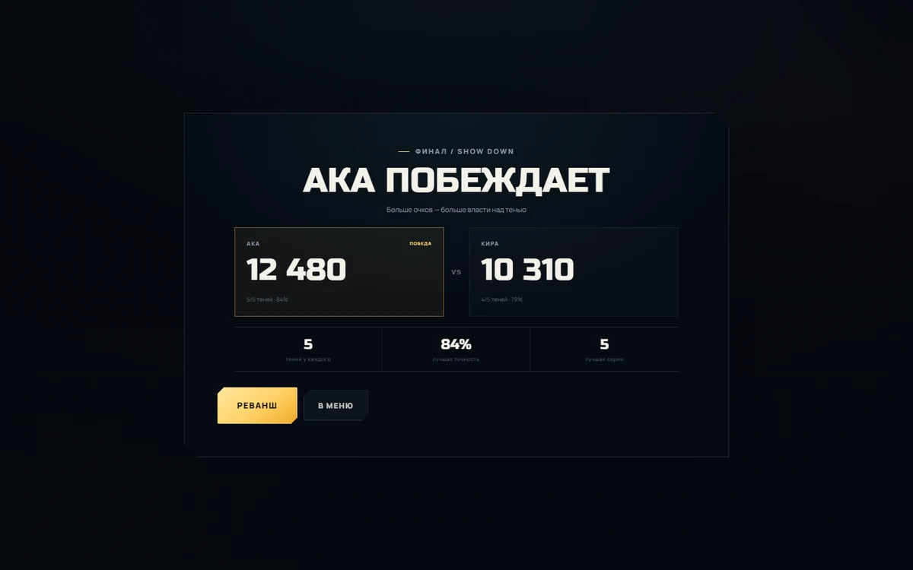
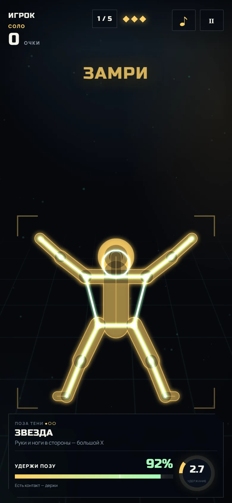

# СИЛУЭТ

**AR-игра для браузера: на вас идёт тень. Повторите её позу и замрите так, чтобы контуры совпали.**

Один телефон, камера и до двух игроков. Без установки приложений, без сервера и без отправки видео куда-либо.

[](#как-выложить-на-github-pages)
[](LICENSE)



---

## Коротко

В японских шоу есть классический номер: на человека движется силуэт, а человек должен встать точно в его позу, чтобы не задеть ни одной лишней частью тела. **СИЛУЭТ** переносит это в браузер.

Телефон стоит напротив игрока и смотрит на него камерой. MediaPipe находит 33 точки тела. На экране появляется тень: она приближается, замирает и показывает позу. Игрок повторяет позу и удерживает её несколько секунд. Игра сравнивает направления рук, предплечий, ног и наклон корпуса. Если точность выше порога — тень проходит сквозь человека. Если нет — минус жизнь.

Это не «настоящий» 3D-AR с привязкой к комнате, а **зеркальная AR-сцена на камере**: камера + распознавание позы + контурный матчинг. Зато работает в Safari на iPhone и в Chrome на Android, где WebXR либо недоступен, либо не умеет главного — понимать положение тела.

| В игре | Дуэль |
|---|---|
|  |  |

<p align="center">
  
</p>

---

## Что уже есть

- **Камера телефона** — фронтальная камера, зеркальный вид, скелет поверх тела.
- **30 одиночных поз + 10 парных**: от «Статуи» и «Звезды» до «Фламинго» и «Кобры», плюс совместные позы для двух человек («Башня», «Мост», «Дай пять» и другие).
- **Настоящий матчинг по углам** — сравниваются 9 направлений: корпус, плечи-предплечья и бёдра-голени. Это не сравнение картинок и не «попал в рамку».
- **Удержание по памяти** — силуэт показывается, пока приближается, а после «ЗАМРИ» почти исчезает: позу нужно держать по памяти. Средняя точность идёт в счёт.
- **Соло** — 5 теней, 3 жизни, серии, личный рекорд в `localStorage`.
- **Бесконечный режим** — тени идут без лимита, пока не кончатся 3 жизни; сложность и очки растут.
- **Дуэль по очереди** — два игрока на одном телефоне, по 5 теней каждый, сравнение очков и точности.
- **Дуэль ×2 (одновременно)** — оба игрока в кадре сразу, одна и та же тень на каждого; соревнование по очкам.
- **Дуэт (совместные позы)** — два игрока вместе собирают одну парную позу; общий счёт и жизни.
- **Таблица лидеров** — локальная (на устройстве), топ-10 по «Соло» и «Бесконечному».
- **Анимации** — тень вырастает из глубины, догоняющие копии, скоростные линии, частицы, вспышки, тряска, разлёт при контакте.
- **Понятная обратная связь** — цвет скелета, полоса точности, порог, подсказка «поправь руку / корпус», вердикт после контакта.
- **Забота о съёмке** — игра ждёт, пока в кадре появятся голова, руки и стопы; таймер останавливается, если игрок вышел из кадра.
- **Мобильный интерфейс** — портрет и ландшафт, safe-area для iPhone, полноэкранный режим, блокировка сна, звук на WebAudio.
- **Без зависимостей и сборки** — чистые HTML/CSS/JS, статический сайт.

---

## Как играть

### Подготовка

1. Поставьте телефон **напротив себя**, на подставку, полку или штатив. Лучше — горизонтально, на высоте груди.
2. Откройте игру и разрешите камеру.
3. Отойдите на **2–3 метра** так, чтобы в кадре были **голова, руки и обе стопы**.
4. Включите свет. Окно за спиной мешает распознаванию.
5. Выберите режим: **«СОЛО»**, **«БЕСКОНЕЧНЫЙ»**, **«ДУЭЛЬ»**, **«ДУЭЛЬ ×2»** или **«ДУЭТ»**.

### Раунд

1. Идёт отсчёт. Тень появляется в глубине сцены.
2. Посмотрите на позу в карточке внизу и на сам силуэт.
3. Пока тень приближается, примите позу.
4. Когда появится **«ЗАМРИ»**, удерживайте позу. Полоса внизу показывает точность и порог.
5. Если точность выше порога — **«ЧИСТО»**, очки и серия. Если ниже — **«ЗАДЕТО»**, минус жизнь.

Цвет скелета: зелёный — хорошо, жёлтый — почти, красный — мимо. Если игрока не видно целиком, игра ставит таймер на паузу и просит вернуться в кадр.

### Дуэль (по очереди)

Игрок 1 проходит свои 5 теней, затем экран передаётся игроку 2. У каждого по 3 жизни. Побеждает тот, у кого больше очков; при равенстве сравнивается средняя точность.

### Бесконечный режим

Тени идут без ограничения по числу. Три промаха — и партия закончена. Чем дальше, тем сложнее позы и больше очков за прохождение. Результат попадает в локальную таблицу лидеров.

### Дуэль ×2 (одновременно)

Оба игрока встают в кадр одновременно — один левее, другой правее. На каждого идёт одна и та же тень. Каждый зарабатывает очки за точность; победитель определяется по счёту (при равенстве — по средней точности).

### Дуэт (совместные позы)

На экране — парная поза на двоих. Оба игрока встают в неё вместе, а игра оценивает, насколько точно совпали обе половинки. Счёт и жизни общие.

> Дуэль, дуэт и «дуэль ×2» — локальная игра на одном телефоне, а не сетевая. Одна камера видит игроков целиком, и матчинг остаётся честным.

---

## Требования

- **HTTPS** (GitHub Pages, Netlify, Vercel, Cloudflare Pages) или `localhost`. По `http://192.168.x.x` браузер камеру не отдаст.
- Современный браузер: Chrome / Safari / Firefox последних версий. На iPhone — Safari.
- Интернет при первом запуске: MediaPipe и модель (~5 МБ) загружаются с CDN и затем кэшируются браузером.
- Свет и расстояние, чтобы человек попадал в кадр целиком.

Камера не обязательна для разработки: есть демо-режим `?demo=1`, где скелет сам повторяет позу тени.

---

## Быстрый запуск

Нужен только Node.js — без npm-пакетов и сборки. Не открывайте `index.html` двойным щелчком: ES-модули и камера работают через HTTP(S), а не через `file://`.

```bash
cd silhouette
node serve.mjs
# или: npm start
# http://localhost:8080
```

На компьютере с веб-камерой можно проверить распознавание. На телефоне по локальной сети камера не откроется из-за HTTP; для телефона используйте туннель или GitHub Pages.

### Туннель для теста с телефона

```bash
node serve.mjs
# в другом терминале:
cloudflared tunnel --url http://localhost:8080
# или:
npx localtunnel --port 8080
```

Полученный `https://…` откройте на телефоне.

### Свой HTTPS

Положите рядом `cert.pem` и `key.pem` (например, из `mkcert`) — `serve.mjs` поднимет HTTPS на порту `8443`. Сертификат нужно установить на телефон.

---

## Как выложить на GitHub Pages

Проект — обычный статический сайт. Сборка не нужна, GitHub Pages отдаёт файлы как есть.

### Вариант 1: через сайт GitHub

1. Создайте новый публичный репозиторий.
2. Загрузите **содержимое папки `silhouette`** в корень репозитория (не саму папку `silhouette`, а файлы внутри: `index.html`, `css/`, `js/`, `.github/` и т.д.).
3. Откройте **Settings → Pages**.
4. В разделе **Build and deployment → Source** выберите **GitHub Actions**.
5. Сделайте пуш в ветку `main` (или запустите workflow вручную: **Actions → Deploy to GitHub Pages → Run workflow**).
6. Через минуту игра будет доступна по адресу:

```text
https://<ваш-username>.github.io/<имя-репозитория>/
```

Это HTTPS-адрес, камера на телефоне будет работать.

Если не хочется использовать Actions, можно выбрать **Deploy from a branch → `main` → `/ (root)`** — проект статический, `.nojekyll` уже лежит в корне. Вариант с Actions удобнее тем, что сайт пересобирается при каждом пуше.

### Вариант 2: через git

```bash
cd silhouette
git init
git add .
git commit -m "СИЛУЭТ: AR-игра на камеру"
git branch -M main
git remote add origin https://github.com/<ваш-username>/<имя-репозитория>.git
git push -u origin main
```

Затем один раз включите Pages: **Settings → Pages → Source: GitHub Actions**.

Готовый workflow лежит в `.github/workflows/pages.yml`. Если ваша ветка называется `master`, поменяйте её в блоке `on.push.branches`.

### Важно для GitHub Pages

- Файл `.nojekyll` уже есть — GitHub не будет обрабатывать сайт через Jekyll.
- Все пути относительные, поэтому игра работает и в подпапке `/<repo>/`.
- Если вы кладёте игру не в корень репозитория, а в подпапку, поправьте `path` в workflow и путь к игре.

---

## Приватность

- Видео с камеры **не отправляется на сервер**. Оно обрабатывается в браузере через MediaPipe Tasks Vision.
- Нет аккаунтов, аналитики, рекламы и базы данных.
- В `localStorage` хранятся только личный рекорд и настройка звука.
- Наружу уходят только запросы за библиотекой и моделью MediaPipe (CDN), а также за шрифтами Google Fonts. Если нужен полностью автономный вариант, библиотеку, WASM и `.task`-модель можно положить в репозиторий и заменить URL в `js/pose.js`.

---

## Как это устроено

```text
камера телефона
      │
      ▼
MediaPipe Pose Landmarker (33 точки)
      │
      ▼
PoseMatcher: углы корпуса, рук и ног
      │
      ├──► живой скелет и цветовая обратная связь
      ├──► сравнение с позой тени
      └──► SilhouetteGame: таймеры, жизни, очки, режимы
                    │
                    ▼
            Canvas 2D: тень, частицы, вспышки
```

- **Почему углы, а не координаты.** Углы не зависят от расстояния до камеры и роста игрока. Сравниваются направления девяти сегментов, а не абсолютные пиксели.
- **Почему зеркало.** Игрок видит себя как в зеркале и интуитивно попадает в силуэт. Точки MediaPipe отражаются по X.
- **Почему силуэт привязан к телу.** Тень масштабируется по расстоянию между плечами и тазом игрока, поэтому «примерка» работает на разном расстоянии от камеры.
- **Почему 2D.** Одна камера не даёт надёжного 3D; фронтальная проекция поз достаточно различима, а ложные срабатывания дешевле, чем WebXR, который не работает на iPhone.

---

## Файлы

```text
index.html                 экраны, HUD, доступность
css/style.css              оформление, адаптив, анимации интерфейса
js/main.js                 состояния, камера, цикл, UI
js/pose.js                 обёртка MediaPipe Pose Landmarker
js/poses.js                данные одиночных и парных поз, геометрия, колода
js/matcher.js              скелет → углы → точность (1 или 2 человека)
js/game.js                 правила соло, дуэли, бесконечного, versus и дуэта
js/scene.js                Canvas: тень, скелет, частицы, вспышки
js/audio.js                синтез звука на WebAudio
js/leaderboard.js          локальная таблица лидеров (localStorage)
manifest.webmanifest       ярлык на главный экран
icon.svg, icon-*.png       иконки приложения
serve.mjs                  локальный сервер без зависимостей
package.json               npm start / npm test
tests/run.mjs              тесты геометрии, матчинга и правил
tests/check-html.mjs       проверка HTML и ссылок
tools/capture.mjs          скриншоты экранов через headless Chrome
tools/camera-test.mjs      проверка камеры и MediaPipe на фейковом видео
docs/                      скриншоты для README
.github/workflows/pages.yml  деплой на GitHub Pages
```

---

## Проверки

```bash
npm test
# то же самое:
node tests/run.mjs
node tests/check-html.mjs
```

`tests/run.mjs` проверяет:

- геометрию всех поз (одиночных и парных);
- матчинг по синтетическим точкам MediaPipe (точная поза проходит, руки вниз — нет);
- ожидание игрока в кадре;
- полный соло-раунд, три поражения, передачу хода в дуэли;
- бесконечный режим (без потолка теней и завершение по жизням);
- versus (два игрока одновременно) и дуэт (совместная поза);
- длительность impact-фазы.

Для скриншотов и проверки реальной ветки камеры:

```bash
node serve.mjs
node tools/capture.mjs
node tools/camera-test.mjs
```

`camera-test` использует фейковую камеру Chrome и проверяет, что MediaPipe загружается, меню открывается, а игра ждёт человека в кадре. Скриншоты складываются в `shots/` (папка в `.gitignore`).

---

## Ограничения

- **Одна камера и 2D-проекция.** Если рука направлена прямо в камеру или сильно перекрыта телом, угол может определиться неточно. Для домашней игры этого достаточно, для спортивной — нет.
- **Нужен полный кадр.** Если не видно стопы, игра честно ставит таймер на паузу, но играть не получится.
- **Свет и фон.** Контровой свет, тёмная одежда на тёмном фоне и зеркала ухудшают распознавание.
- **Первая загрузка — интернет.** Модель тянется с CDN. Полностью офлайн-режим не заявлен.
- **Два человека в кадре — это 2D.** В режимах «дуэль ×2» и «дуэт» игра различает двух людей по положению на экране (левее/правее). Если игроки меняются местами или сильно пересекаются, стороны могут определиться неверно.
- **Это не WebXR.** Комната не сканируется, тень не привязана к стенам и мебели. Это осознанный компромисс ради iPhone и простоты.

---

## Идеи для развития

- Глобальная таблица лидеров (Supabase / Cloudflare D1) — сейчас она локальная, на устройстве.
- Запись лучшего момента в видео.
- Режим тренировки с подсказками по каждому суставу.
- Свои позы: редактор и ссылка-челлендж.
- Полностью локальная сборка MediaPipe без CDN.

---

## Лицензия

MIT. Можно использовать, менять и выкладывать. См. [LICENSE](LICENSE).

Название и оформление — оригинальные. Игра вдохновлена телевизионными номерами с тенями, но не использует чужие ассеты, видео или персонажей.

Технологии: [MediaPipe Tasks Vision](https://developers.google.com/mediapipe) (Apache-2.0), шрифты Russo One и Manrope (SIL Open Font License). Звук синтезируется на месте, аудиофайлов нет.
